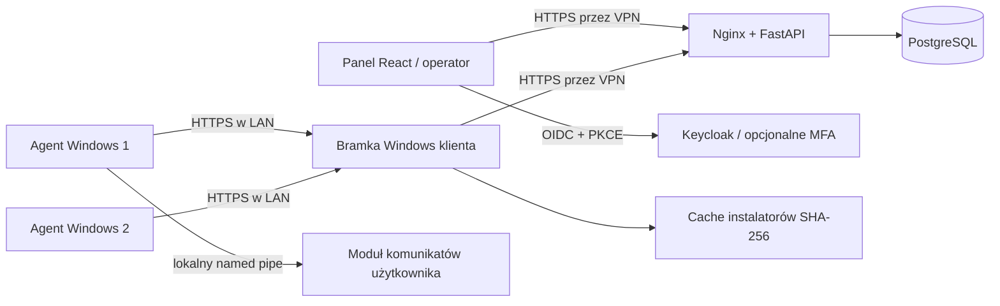

# PC MED RMM — MVP

Centralny panel zarządzania komputerami Windows klientów: FastAPI, PostgreSQL, React oraz usługi Windows .NET 10 LTS. Agent odpytuje centralę przez HTTPS, bez otwierania portów na stacjach roboczych. U klienta wystarczy **jedna bramka z VPN**; pozostałe komputery korzystają z jej adresu LAN.

To kod MVP do uruchomienia i pilotażu w kontrolowanej sieci. Repozytorium i PR nie oznaczają wdrożenia produkcyjnego. Konfiguracja serwera, VPN, DNS, certyfikatów, kopii zapasowych i kont pozostaje po stronie instalacji.



## Dostępne funkcje

- Klienci, przypisane komputery, status online po heartbeat, unieważnianie agentów.
- Jednorazowe tokeny rejestracji: 15 minut ważności, w bazie wyłącznie SHA-256.
- Bramka LAN przypisana do klienta, odwoływalny token, HTTPS, buforowanie instalatorów i limit zajętości dysku.
- Biblioteka niezmiennych definicji MSI, EXE, BAT i PowerShell. Każdą definicję wykonawczą zatwierdza **inna osoba** z uprawnieniami. Jest to zatwierdzanie treści, niezależne od opcjonalnego MFA.
- Zadania na jednym lub maksymalnie 100 komputerach, atomowe sprawdzanie listy odbiorców, historia, kod wyjścia i ograniczony log.
- Komunikaty tekstowe dla aktywnej sesji Windows; osobny program UI rozwiązuje ograniczenie sesji 0 usług Windows.
- Role, separacja klientów w API i złożonych kluczach obcych, audyt operacji.
- Migracje Alembic, Compose, testy backendu, panelu i zasad Windows oraz GitHub Actions.

## Uruchomienie centrali

Wymagania: serwer Linux z Docker Engine i Compose v2, Python 3.12+, prywatny adres interfejsu VPN, DNS dostępny dla operatorów i bramek oraz certyfikat HTTPS z zaufanego CA. Przykłady nazw i adresów poniżej należy dostosować do swojej sieci.

```sh
python scripts/configure.py \
  --hostname rmm.pcmed.lan \
  --vpn-bind 10.44.0.1 \
  --artifact-host rmm.pcmed.lan
```

Skrypt tworzy `.env` z losowymi hasłami oraz `secrets/realm.json`, `secrets/frontend-config.json` i `secrets/packages/`. Nie nadpisuje istniejącej konfiguracji. Na Windows dodatkowo ogranicz ACL `.env` i `secrets/` do administratora; prawa POSIX nie zastępują ACL Windows.

1. Umieść certyfikat z pełnym łańcuchem w `secrets/tls.crt`, a klucz prywatny w `secrets/tls.key`. Ogranicz dostęp do klucza, np. `chmod 600 secrets/tls.key`.
2. Skieruj prywatny DNS `rmm.pcmed.lan` na `10.44.0.1`. Zapora ma dopuszczać 443 wyłącznie z VPN i administracyjnej sieci zarządzania. Bez przekierowania portów z internetu.
3. Uruchom `docker compose config --quiet`, następnie `docker compose up --build -d`.
4. Sprawdź `docker compose ps` i `docker compose logs --tail 100 api keycloak migrate`. Migracja musi zakończyć się powodzeniem, API przejść healthcheck, a Keycloak zakończyć import realm.
5. Otwórz `https://rmm.pcmed.lan/`. Bazy, API i Keycloak nie publikują osobnych portów hosta i korzystają z wydzielonych sieci wewnętrznych. Jedynie Nginx jest dodatkowo dołączony do sieci brzegowej, aby obsłużyć opublikowany port HTTPS przypisany do adresu VPN hosta.

W środowisku testowym można wystawić własny CA, ale trzeba zainstalować jego certyfikat jako zaufany w przeglądarkach oraz magazynie **LocalMachine Root** bramek i agentów. Nie wyłączamy sprawdzania certyfikatów. Sam VPN nie zastępuje HTTPS.

Instalatory można umieszczać ręcznie w `secrets/packages/`, np. `app.msi` będzie dostępny jako `https://rmm.pcmed.lan/packages/app.msi`. Repozytorium pakietów jest dostępne w prywatnej sieci, bez osobnego logowania; nie umieszczaj tam sekretów. Alternatywnie użyj własnego repozytorium HTTPS i dodaj jego host do allowlisty centrali i bramki. Adres musi wskazywać bezpośrednio plik: przekierowania są odrzucane.

## Konta, role i opcjonalne MFA

Wbudowany Keycloak używa Authorization Code + PKCE S256. Logowanie hasłem odbywa się u dostawcy tożsamości; panel nie przechowuje haseł. Direct Access Grants i implicit flow są wyłączone. Tokeny panelu są trzymane w pamięci, a stan wymiany kodu w `sessionStorage`. Odświeżenie strony wymaga ponownego przekierowania do logowania; istniejąca sesja SSO zwykle wystarcza. Access token wygasa po 5 minutach, sesja SSO maksymalnie po 8 godzinach.

1. Wejdź na `https://rmm.pcmed.lan/admin/`. Konto techniczne pierwszego uruchomienia: `bootstrap-admin`, hasło z `KEYCLOAK_ADMIN_PASSWORD` w lokalnym `.env`.
2. Utwórz imienne konto administratora Keycloak i usuń konto bootstrap po konfiguracji. Nigdy nie używaj kont technicznych jako kont operatorów.
3. W realm **pcmed** utwórz użytkowników, ustaw mocne hasła i przypisz role realm:

| Rola | Zakres |
| --- | --- |
| `platform_admin` | Wszyscy klienci, tworzenie klientów, operacje i zatwierdzanie; nadal bez zatwierdzania własnej definicji |
| `operator` | Rejestracje, bramki, definicje, zadania, komunikaty i unieważnianie agentów we własnych klientach |
| `approver` | Przegląd, zatwierdzanie cudzych i wycofywanie definicji we własnych klientach |
| `viewer` | Odczyt komputerów, zadań, wyników, definicji i audytu we własnych klientach |

4. Zaloguj się kontem `platform_admin`, utwórz klienta i skopiuj jego pełny identyfikator ze stopki panelu.
5. W Keycloak utwórz **grupę o nazwie dokładnie równej identyfikatorowi klienta**. Dodaj do niej uprawnionych użytkowników. Mapper grup tworzy tablicę `tenant_ids` w access tokenie. Role bez członkostwa w odpowiedniej grupie nie otwierają dostępu do klienta. Użytkownik może należeć do kilku klientów. Po zmianach zaloguj go ponownie.
6. Do zatwierdzania treści potrzebne jest drugie imienne konto, np. z rolą `approver` i członkostwem w tej samej grupie.

**MFA jest opcjonalne.** Domyślny browser flow Keycloak stosuje OTP tylko dla kont, które skonfigurowały drugi składnik. Użytkownik może włączyć go w `https://rmm.pcmed.lan/realms/pcmed/account/`, a administrator wymusić dla wybranego konta przez required action `Configure OTP`. Nie ma obowiązkowego OTP dla wszystkich użytkowników.

Backend sprawdza podpis RS256, `iss`, `aud=pcmed-api`, daty ważności, role i `tenant_ids`; nie ufa nagłówkom z tożsamością użytkownika. Przy zewnętrznym OIDC odtwórz te same claimy i ustaw `PCMED_OIDC_ISSUER`, `PCMED_OIDC_JWKS_URL`. Adres JWKS może być wewnętrznym HTTP wyłącznie na kontrolowanej sieci Compose. Realm Keycloak ma politykę SSL `external`, aby API mogło pobierać publiczne klucze bezpośrednio w tej sieci. Dostęp z hosta odbywa się wyłącznie przez HTTPS Nginx, a issuer pozostaje HTTPS. Błędny podpis, odbiorca lub issuer jest odrzucany.

Zmiany ról i blokada konta obowiązują istniejące tokeny po maksymalnie 5 minutach. W sytuacji awaryjnej zablokuj sieć dostępu lub wyłącz API. Unieważnienie tokenów urządzenia/bramki jest sprawdzane w bazie przy każdym żądaniu.

## Budowanie programów Windows

Wymagania: Windows 11 / wspierany Windows Server, SDK .NET 10 oraz PowerShell 7.2+. Publikacja jest framework-dependent, więc na komputerach docelowych potrzebne są aktualne wydania .NET 10: Desktop Runtime dla UI i ASP.NET Core Runtime dla bramki. Zainstalowanie SDK zapewnia środowisko do testów; na końcówkach wystarczą odpowiednie runtime.

```powershell
cd windows
dotnet restore PcMed.sln --locked-mode
dotnet test PcMed.sln -c Release --no-restore
cd ..
./scripts/publish-windows.ps1
```

Wyniki znajdują się w `artifacts/windows/Agent`, `Gateway` i `Notifier`. Katalog Agent zawiera podkatalog Notifier. CI również publikuje te pliki jako artefakt `windows-mvp`. Używaj całych katalogów, z konfiguracją i zależnościami.

## Bramka klienta: jeden komputer z VPN

1. W panelu wybierz klienta → **Bramki LAN** → dodaj bramkę. Token jest pokazywany jeden raz.
2. Wybierz stały komputer Windows z VPN do centrali, skonfiguruj nazwę DNS w LAN, np. `gateway.firma.lan` → `192.168.20.10`.
3. Zainstaluj w `LocalMachine\My` certyfikat HTTPS z SAN `gateway.firma.lan`, kluczem prywatnym dostępnym dla LocalSystem i pełnym zaufaniem CA na końcówkach. Produkcyjnie używaj certyfikatu z własnego firmowego CA lub innego zaufanego CA.
4. W PowerShell 7 jako administrator uruchom:

```powershell
./scripts/install-windows.ps1 -Component Gateway `
  -PublishDirectory ./artifacts/windows/Gateway `
  -Endpoint https://rmm.pcmed.lan `
  -ArtifactHosts rmm.pcmed.lan `
  -LanDnsName gateway.firma.lan -LanSubnet 192.168.20.0/24
```

Skrypt poprosi o token bez wypisywania go na ekran. Utworzy usługę `PcMedGateway` i regułę zapory TCP 7443 ograniczoną do podanej podsieci, profilu Domain/Private i programu. Konfiguracja jest w `C:\Program Files\PcMed\Gateway\appsettings.json`. Sekret i cache w `C:\ProgramData\PcMed\Gateway` są chronione ACL administratorów/System; sekret dodatkowo DPAPI LocalMachine.

Bramka udostępnia wyłącznie wskazane trasy agenta, a nie panel ani dowolny proxy URL. Dodaje swój token do połączenia z centralą, która sprawdza zgodność klienta. Dostęp do instalatora wymaga aktywnego zadania i prawidłowego tokenu urządzenia. Bramka pobiera plik dopiero po uzyskaniu uprawnionego ticketu, nie przesyła bearer tokenów agentów do serwera pakietów, odrzuca przekierowania i weryfikuje hash. Cache jest adresowany SHA-256; domyślnie do 10 GiB, plik do 512 MiB. Przy każdym użyciu sprawdzany jest hash pliku cache. Bramka wymaga zaufania administratora klienta, bo kończy połączenie TLS agentów.

MVP nie przechowuje na bramce zadań offline. Kiedy zniknie VPN, agenci ponawiają połączenia, a centrala po 90 sekundach pokaże ich jako offline. Gdy wróci łączność, pobiorą oczekujące zadania. Cache oszczędza ponowne pobieranie instalatora przez VPN, ale nie omija autoryzacji z centralą.

## Rejestracja komputerów LAN

W panelu **Komputery → Zarejestruj komputer** wygeneruj osobny token dla każdej końcówki. Na tej końcówce, w PowerShell 7 jako administrator:

```powershell
./scripts/install-windows.ps1 -Component Agent `
  -PublishDirectory ./artifacts/windows/Agent `
  -Endpoint https://gateway.firma.lan:7443
```

Podaj token w ukrytym monicie. Agent nie wymaga VPN ani dostępu do internetu; instalatory pobiera z bramki po LAN. Usługa działa jako LocalSystem, stan i dziennik w `C:\ProgramData\PcMed\Agent` mają ACL System/administratorzy i ochronę DPAPI. Na końcówce nie otwieramy portów przychodzących.

Moduł Notifier uruchamia się przy **kolejnym logowaniu użytkownika** przez wpis HKLM Run. Aby odebrać komunikaty w już otwartej sesji, uruchom ręcznie `C:\Program Files\PcMed\Agent\Notifier\PcMed.Notifier.exe` jako zwykły użytkownik. Brak aktywnej sesji/UI daje timeout komunikatu, a nie fałszywe potwierdzenie odczytania. Named pipe przyjmuje tylko lokalne sesje interaktywne, odmawia dostępu sieciowego i nie oferuje komend wykonawczych. Wiadomość trafia do jednej sesji na komputerze; rozsyłanie do wszystkich sesji RDS nie jest częścią MVP.

Dla komputera z własnym VPN można pominąć bramkę:

```powershell
./scripts/install-windows.ps1 -Component Agent `
  -PublishDirectory ./artifacts/windows/Agent `
  -Endpoint https://rmm.pcmed.lan -DirectVpn -ArtifactHosts rmm.pcmed.lan
```

Na komputerze bramki może równolegle działać agent, jeśli sam komputer także ma być zarządzany. Są to osobne usługi i sekrety.

## Instalacje i skrypty

1. Dodaj definicję w Bibliotece. MSI/EXE wymagają bezpośredniego adresu HTTPS z allowlisty oraz SHA-256 pliku. Hash uzyskasz np. `Get-FileHash .\app.msi -Algorithm SHA256`. Argumenty podaj jako tablicę JSON: `["/quiet", "/norestart"]`. MSI otrzymuje automatycznie `/i <plik> /qn /norestart`.
2. BAT/PowerShell wymagają pełnej treści skryptu; hash pliku UTF-8 oblicza serwer. PowerShell ma BOM, aby Windows PowerShell 5.1 prawidłowo odczytywał polskie znaki; BAT jest bez BOM (w skrypcie używającym UTF-8 ustaw `chcp 65001`). Nie ma edycji zatwierdzonej wersji ani dopisywania argumentów w chwili zlecania. Nowa treść oznacza nową definicję i nową zgodę.
3. Druga osoba przegląda treść, URL, hash, argumenty i limit czasu, a następnie zatwierdza. Rola administratora nie omija wymogu innej osoby.
4. W Komputerach zaznacz odbiorców i wybierz zatwierdzoną operację. Potwierdź uruchomienie. Wyniki są w Zadaniach; HTML z wyników jest prezentowany jako zwykły tekst.

Zatwierdzone instalatory i skrypty wykonują się z wysokimi uprawnieniami. **To nie jest sandbox dla niezaufanego kodu.** Przed zatwierdzeniem sprawdź pochodzenie, podpis wydawcy i treść pakietu; hash zapewnia zgodność z zatwierdzoną wersją, nie ocenę bezpieczeństwa programu. Windows PowerShell uruchamia się z `-NoProfile -NonInteractive -File`, bez `ExecutionPolicy Bypass`. Polityka wykonania końcówki nadal obowiązuje. Jeśli wymaga podpisów, podpisz treść skryptu zgodnie z polityką firmy. BAT używa systemowego `cmd.exe`; inne procesy korzystają z `ArgumentList`, bez powłoki pośredniej.

Limit czasu wynosi 10–3600 s. Agent ogranicza wynik do 32768 znaków, sprawdza hash przed uruchomieniem, używa chronionego katalogu roboczego i Windows Job Object z `KILL_ON_JOB_CLOSE`. Przypisanie procesu do obiektu następuje bezpośrednio po starcie; nie stanowi granicy bezpieczeństwa przeciw złośliwemu zatwierdzonemu programowi. Instalator może uruchomić usługę lub zlecić operację systemową, której zamknięcie drzewa procesu nie cofnie. Kod MSI 3010 oznacza sukces z wymaganym restartem; restart nie jest automatycznie wykonywany.

## Niezawodność i stan „Do weryfikacji”

Serwer rezerwuje zadanie atomowo, a w PostgreSQL blokuje wiersz urządzenia i zadania. Agent zapisuje trwały dziennik przed wykonaniem, a wynik przed wysyłką. Utrata odpowiedzi na wysłany wynik powoduje ponowne wysłanie **tego samego wyniku**, nie ponowne wykonanie.

Nie gwarantujemy exactly-once efektów systemowych. Zerwanie połączenia przy odbiorze zadania, awaria procesu, przerwanie lub timeout może dać `unknown` („Do weryfikacji”). Zadanie nie wraca automatycznie do kolejki. Po restarcie agent zgłasza niepewny wynik z dziennika i nie wykonuje treści drugi raz. Serwer uznaje brak wyniku za niepewny po limicie czasu + 120 s; spóźniony prawidłowy wynik może jeszcze zostać zapisany. Operator sprawdza końcówkę przed świadomym zleceniem nowej operacji.

Anulować można tylko zadanie oczekujące. Wycofanie definicji anuluje jej oczekujące zadania; odwołanie agenta anuluje jego kolejkę. Żadna z tych operacji nie cofa już rozpoczętej instalacji. Awaria bramki nie powoduje automatycznego powtórzenia wykonania.

## Testy i rozwój

```sh
python -m venv .venv
# Aktywuj .venv odpowiednio dla systemu.
pip install -r backend/requirements.lock -e 'backend[test]' pip-audit
cd backend
pytest -q
cd ../frontend
corepack enable
pnpm install --frozen-lockfile
pnpm test
pnpm run build
pnpm audit --audit-level high
```

Szybkie testy API używają SQLite z aktywnymi FK. Test równoległego pobierania zadań wymaga prawdziwego PostgreSQL: ustaw `TEST_DATABASE_URL` na **dedykowaną pustą bazę testową**. Fixture testowa usuwa i tworzy tabele — nigdy nie wskazuj bazy instalacji. CI korzysta z PostgreSQL 17, sprawdza migrację i zgodność schematu, izolację klientów, rejestrację, gateway, uprawnienia, podpisy JWT, przejścia stanów, blokady i idempotencję wyników. Osobne zadania budują panel, Windows, publikują binaria oraz uruchamiają Compose i sprawdzają discovery OIDC/odrzucenie nieuwierzytelnionego API.

Backend lokalnie: ustaw `PCMED_DATABASE_URL`, `PCMED_OIDC_ISSUER`, `PCMED_OIDC_JWKS_URL`, `PCMED_ARTIFACT_HOSTS`, uruchom `alembic upgrade head`, potem `uvicorn app.main:app`. API jest pod `/api`, healthcheck pod `/healthz` wyłącznie wewnątrz Compose. Dokumentacja Swagger nie jest publicznie wystawiona. Panel korzysta z pliku `/config.json`; w Compose generuje go konfigurator.

## Eksploatacja i granice MVP

- Audyt jest dopisywany w tej samej transakcji co zmiana. Nie ma API do edycji/usuwania audytu. Administrator bazy może jednak go zmienić; przed produkcją wyślij kopię do zewnętrznego, niezmiennego magazynu. Odmowy 401/403 trafiają do globalnego audytu bez tokenów i payloadów.
- Wyniki i skrypty mogą zawierać dane klienta. Dostęp mają przypisane role odczytu. Ustal retencję i kopie zapasowe zgodnie z własnymi zasadami; MVP nie usuwa automatycznie wyników.
- Wykonuj i testuj odtwarzanie backupów obu baz oraz `.env`, konfiguracji realm, kluczy TLS i ustawień Windows. DPAPI jest związane z maszyną; przeniesienie pliku sekretu na inny komputer wymaga ponownej rejestracji.
- Aktualizacje: najpierw backup i test na środowisku pilotażowym, potem `docker compose build`, migracja i start usług. Import realm działa tylko dla nowego realm; zmiana pliku nie aktualizuje istniejącej konfiguracji Keycloak.
- Windows: zatrzymaj usługę, zachowaj chroniony katalog ProgramData, wymień binaria z przetestowanej publikacji i ponownie uruchom. Instalator nie nadpisuje istniejącej usługi. Przed ponowną rejestracją unieważnij stare urządzenie/bramkę w panelu.
- Cache można usunąć przy zatrzymanej bramce; pakiety zostaną pobrane ponownie po autoryzacji. Nie usuwaj dziennika agenta w celu „naprawy” zadania — najpierw ustal jego skutki.
- Listy komputerów, zadań i audytu są stronicowane po 200 rekordów. Wysyłka komunikatów w MVP wybiera spośród pierwszych 200 urządzeń klienta. Brak harmonogramów, zdalnego pulpitu, aktualizacji agenta, cache skryptów offline i automatycznych rollbacków instalacji.
- Nie instalujemy lokalnego CA, usług ani reguł zapory w trakcie zwykłych testów. Pilotaż musi objąć rzeczywiste VPN/LAN, zaufanie certyfikatów, wylogowanie/zalogowanie użytkownika, komunikat, instalację testowego pakietu, utratę VPN i restart usługi w trakcie zadania.

Dokumentacja bazowa: [FastAPI security](https://fastapi.tiangolo.com/tutorial/security/oauth2-jwt/), [OIDC w Keycloak](https://www.keycloak.org/securing-apps/oidc-layers), [Windows Worker Service](https://learn.microsoft.com/en-us/dotnet/core/extensions/windows-service), [wsparcie .NET](https://dotnet.microsoft.com/en-us/platform/support/policy/dotnet-core).
